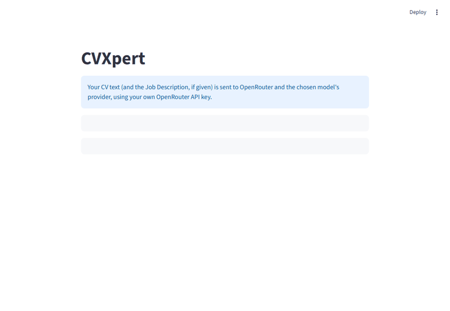
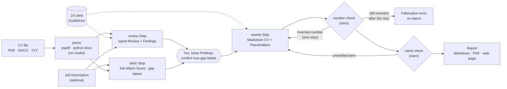

# CVXpert

[](https://github.com/Chamiln17/CVXpert/actions/workflows/ci.yml)
[](LICENSE)


**A CV reviewer that cites its sources and refuses to make things up.**

CVXpert reviews a CV against 24 rules from university career services, optionally tailors it to a job description, and rewrites it. Every suggestion names the rule it is based on, and checks in code stop the rewrite from inventing numbers or quietly adding tools, employers or titles that are not in your CV. It runs locally, with your own model key.



## Why it is different

- **Grounded, not opinionated.** Each Finding cites one of 24 Guidelines (G01 to G24), each backed by sources such as Harvard, MIT and the UK National Careers Service. You can read the rule behind every suggestion.
- **No Fabrication.** Generic AI rewriters invent metrics ("increased revenue by 40%"). CVXpert's Rewrite may only use facts from your CV or that you confirm; where a fact is missing it writes a Placeholder like `[X%]` for you to fill in. Invented numbers are rejected in code; invented names are flagged for you to check.
- **You stay in control.** Untick Findings you disagree with. Tick "I have this" next to a skill the job asks for that you really have, and only then may the Rewrite use it.
- **Honest about limits.** Scores are labelled as the model's estimates, and the known gaps of the checks are documented below.

## Architecture

CVXpert is a fixed pipeline of four Steps written as plain Python functions, not a multi-agent framework: the task is a sequence with one optional branch, so a graph framework would add complexity without value ([ADR 0001](docs/adr/0001-plain-workflow-not-langgraph.md), backed by [this research note](docs/research/agentic-architectures.md)).



- **LLM Steps** (review, tailor, rewrite) are [PydanticAI](https://ai.pydantic.dev/) agents with typed Pydantic outputs, called through [OpenRouter](https://openrouter.ai/). Default model: `deepseek/deepseek-v4.1-flash`; any OpenRouter model with tool support can be set with `CVXPERT_MODEL`.
- **Validators in code** run on every model answer: a Finding must cite a real Guideline ID; every number in the Rewrite must appear in the CV or a Confirmed Gap; names, tools and acronyms that do not are reported as Unverified Terms. The model gets one retry with the problem named.
- **Interfaces**: a CLI (`cvxpert review`) and a Streamlit page (`cvxpert web`) call the same two-phase Pipeline, so the web page can let you choose Findings and confirm gaps between the review and the rewrite.

## Engineering highlights

- **Tests never spend money.** The suite drives the real Pipeline, CLI and web page with PydanticAI fake models, and real model requests are disabled globally, so CI needs no key.
- **Paid runs have a hard ceiling.** The live smoke script refuses to run unless the OpenRouter key has a credit limit of at most $1, and reports the real spend afterwards.
- **CI** runs lint, format check, tests and a licence check that fails on GPL and AGPL licences, while LGPL and MPL are allowed (an AGPL PDF library was caught and replaced during development). Actions are pinned to commit SHAs, and Dependabot, CodeQL and secret scanning are enabled.
- **Documented decisions**: a spec, an architecture decision record, two research notes with sources, and a glossary of the project's terms live in [`docs/`](docs) and [`GLOSSARY.md`](GLOSSARY.md).

**Built with** Python 3.11+, PydanticAI, OpenRouter, Streamlit, pypdf, python-docx, markdown + fpdf2, uv, ruff, pytest and GitHub Actions.

> **Privacy:** a CV is personal data. Every run sends the CV text (and the Job Description, if given) to OpenRouter and the chosen model's provider, using your own OpenRouter API key. Nothing else leaves your machine, and CVXpert stores nothing beyond the report files you ask it to write.

## Quick start

Requires Python 3.11+, [uv](https://docs.astral.sh/uv/) and an [OpenRouter](https://openrouter.ai/) API key.

```sh
git clone https://github.com/Chamiln17/CVXpert.git
cd CVXpert
uv sync
cp .env.example .env          # then put your key in OPENROUTER_API_KEY
uv run cvxpert web            # the web page
uv run cvxpert review examples/cv.txt --job examples/job-description.txt   # or the CLI
```

`examples/` holds a fictional CV with deliberate weaknesses and a fictional Job Description to try it on.

Configuration, from the environment or a `.env` file (see `.env.example`):

- `OPENROUTER_API_KEY`: required; checked before any Step runs.
- `CVXPERT_MODEL`: the OpenRouter model to use. Default: `deepseek/deepseek-v4.1-flash`.

A run makes two paid requests (review and rewrite), three with a Job Description; each Step may retry once. Two live runs on the default model cost about $0.021 and $0.028.

## Example

Real output from one live run of `scripts/smoke.py` (2026-10-08, about $0.028) on the fictional `examples/cv.txt` with `examples/job-description.txt`. The full report is in [`examples/sample-report.md`](examples/sample-report.md).

Before (from the CV):

```
Software Developer, Brightfield Logistics (fictional)
March 2021 - Present
- Responsible for the company website and the internal booking tool.
- Worked on various tasks related to the API.
- Helped with projects for the warehouse team.
- Reports were prepared for management every month.
- Fixed bugs and attended daily stand-ups with the team.
```

After (from the Rewrite):

```
**Software Developer, Brightfield Logistics (fictional)**
Mar 2021 - Present
- Build and maintain the company website and the internal booking tool.
- Build and maintain [endpoint/feature] on the API using [language/tool].
- Deliver [what] for the warehouse team using [tools], [result].
- Prepare monthly [type of] reports for management, [result].
- Diagnose and fix [number/type] bugs, [result].
- Take part in daily stand-ups with the team.
```

The Review behind it had 23 Findings (Overall Score 40/100), for example G09 for "Responsible for…", G12 for the passive "Reports were prepared", and G23 for the unexplained 13-month gap. The Tailoring gave a Job Match Score of 58/100 and listed PostgreSQL, CI/CD and Kubernetes as gaps rather than adding them; the Rewrite adds none of them.

This run checked the stricter rewrite rule live: the Rewrite keeps the CV's "the API" and adds no Job Description term such as "REST". One mild claim upgrade remains: "Build and maintain [endpoint/feature] on the API" says more than "Worked on various tasks related to the API.", and neither check catches a lowercase upgrade like this (see Known gaps). Check every Rewrite before you send it.

## How it works in detail

<details>
<summary><b>Command line</b></summary>

One command reviews and rewrites a CV and writes a Markdown or PDF report:

```sh
uv run cvxpert review examples/cv.txt
uv run cvxpert review examples/cv.txt --job examples/job-description.txt
uv run cvxpert review examples/cv.txt --job examples/job-description.txt --confirm "PostgreSQL" --confirm "CI/CD"
uv run cvxpert review path/to/cv.pdf --out review.md
uv run cvxpert review path/to/cv.pdf --format pdf
```

The report holds the Review, the Tailoring (with `--job`) and the Rewrite. The Review has:

- an Overall Score from 0 to 100, labelled as the model's estimate, not a measurement;
- a short summary;
- the CV's Sections as the model found them;
- the Findings, high severity first. Each names the Section, the affected text, the problem, a proposed change and the Guideline it cites, and may be marked uncertain;
- the title, full Rule and sources of every Guideline cited.

`--format md` (the default) writes the report as Markdown; `--format pdf` writes the same report as a PDF. Without `--out`, the report is written next to the CV as `<CV name>.cvxpert.md` or `<CV name>.cvxpert.pdf`. The PDF is plain: Markdown is converted to HTML with `markdown`, then to PDF with `fpdf2`, in a bundled Noto Sans font that covers Latin scripts, dashes, curly quotes and currency signs. Characters outside that set (emoji, non-Latin scripts) are left out of the PDF with a warning.

When the run fails, the command prints one `cvxpert: error: ...` line to stderr and exits with code 1 (bad arguments print argparse usage and exit with code 2). Failures include a missing API key, a missing, unreadable or empty Job Description file, an unsupported file type, a file over 10 MB, a scanned PDF with no extractable text, a review, tailor or rewrite Step that returns invalid output twice, and a Rewrite that invents a number twice.

</details>

<details>
<summary><b>Tailoring and Confirmed Gaps</b></summary>

`--job <file>` takes a Job Description as a UTF-8 text file. The review Step then sees the Job Description and may cite G05 and G06, the Guidelines that need a target job. A tailor Step compares the CV text with the Job Description, and the report gains a Tailoring section:

- a Job Match Score from 0 to 100, labelled as the model's estimate;
- a short summary;
- matches: what in the CV the Job Description asks for;
- gaps: what the Job Description asks for that the CV does not show, each with a short label naming the skill or requirement (say, "PostgreSQL" or "Python, 3+ years") and a detail saying why it is a gap. Gaps are reported, never added to the CV; only you know whether you have that experience;
- what to emphasise: content already in the CV to move up or give more space.

If a gap is true of you but missing from your CV, confirm its label with `--confirm "<label>"`, once per gap (for example `--confirm "PostgreSQL" --confirm "CI/CD"`), or tick "I have this" on the web page. On the CLI a Confirmed Gap is free text, normally the label as the report shows it; it may carry a number ("Python, 3+ years"). The web page confirms only the label, never the detail, so a detail cannot widen what the checks accept. The rewrite Step receives Confirmed Gaps as facts you supplied and may use them; they are the only Job Description terms it may add. Both checks in code treat Confirmed Gaps as CV text, so a confirmed term is not an Unverified Term and a confirmed number is not a Fabrication. The report lists your Confirmed Gaps in the Rewrite section. `--confirm` needs `--job`; without it the command prints one error line and exits with code 1.

Without `--job`, the tailor Step does not run, the report has no Tailoring and no Job Match Score, and any Finding citing G05 or G06 is dropped.

</details>

<details>
<summary><b>The Rewrite and its checks</b></summary>

The rewrite Step sees the CV text, the Findings, the Tailoring (if any) and the Guidelines, and returns the whole CV in Markdown. The command keeps every Finding; in Python, `cvxpert.pipeline.rewrite_phase(result, kept_ids, confirmed_gaps)` rewrites applying only the Findings whose IDs you keep, with any Confirmed Gaps. Its instructions tell the model to keep your facts, voice and specifics, and to take only what to emphasise from the Tailoring, never its gaps unless you confirmed them. They also forbid any Job Description term your CV does not contain, other than a Confirmed Gap, and any raised claim: "worked on" must not become "developed", and "the database" must not become "relational database". A G06 Finding is advice for you ("if accurate, consider the posting's term X"); the Rewrite never applies a posting term itself.

**No Fabrication.** The Rewrite may not add a number, employer, title, tool, skill, date or outcome that your CV does not contain. Where a fact would strengthen a line but your CV lacks it, the Rewrite shows a Placeholder in brackets, such as `[X%]`, `[result]`, `[team size]` or `[dates]`, for you to fill in. The report lists every Placeholder above the rewritten CV.

**Number check (strict).** Every number, percentage and year in the Rewrite must appear in the CV text. Thousands separators, percent signs and trailing decimal zeros are ignored when comparing (`1,200` matches `1200`, `40%` matches `40`, `3.80` matches `3.8`); leading zeros are not (`06/2018` does not match `6/2018`). Placeholders and numbered-list markers such as `1.` at the start of a line are skipped. If the Rewrite holds a number your CV does not, the model gets one retry with the offending numbers named; if the retry still holds one, the command fails with a Fabrication error and writes no report.

**Name check (warns).** It looks for Unverified Terms: names, tools, acronyms and titles in the Rewrite that your CV does not contain. It looks at capitalised words and phrases (say, "Kubernetes" or "Amazon Web Services"), acronyms such as "REST" or "CI/CD", and tech-shaped tokens such as "Node.js", "C++" or "Python3", and compares them with your CV's words, ignoring case ("JavaScript" matches "Javascript"). It skips an ordinary capitalised word that starts a line, bullet or sentence (usually a verb), month names, common Section names such as Experience or Skills, Placeholders and Markdown markers. If the Rewrite holds such a term, the model gets one retry with the terms named; that retry is the same one the number check uses. Terms still there after the retry do not fail the run: the report and the web page list them under "Check these terms" so you can remove any that are not true of you.

**Known gaps.** These are forbidden by the rewrite Step's instructions but not caught in code:

- a lowercase claim upgrade (say, "worked on" turned into "developed", or "the database" into "relational database"), and a capitalised word at the start of a line, bullet or sentence, such as an invented "Develop";
- a name, tool or acronym your CV already contains, reused in a new context (say, your employer's name attached to a project you did elsewhere), because the name check only asks whether the word appears anywhere in the CV;
- a lowercase tool or term (say, "iOS" or "kubectl"), because the name check looks only at capitalised words, acronyms and tech-shaped tokens;
- a number written as a word (say, "led a team of five" when your CV gives no team size);
- a number from your CV reused in a new context (say, your "30%" cut in load time turned into a 30% rise in sales), because the number check only asks whether the number appears anywhere in the CV.

Read the Rewrite before you send it.

</details>

<details>
<summary><b>The web page</b></summary>

`uv run cvxpert web` opens a Streamlit page in your browser (it runs `streamlit run` on `cvxpert/web.py` with the current Python). Upload a CV (PDF, DOCX or TXT), optionally paste a Job Description, and press Review. The page shows the Overall Score and, with a Job Description, the Job Match Score, both labelled as the model's estimate, then the Findings grouped by severity, each with the ID and title of the Guideline it cites and an expander with that Guideline's full Rule and sources. Every Finding has a tick box, ticked by default; untick the ones you reject. With a Job Description, each Tailoring gap shows its label and detail with an "I have this" tick box, unticked by default; tick the gaps that are true of you to make their labels Confirmed Gaps. Press Rewrite. The Rewrite applies only the ticked Findings (plus the Tailoring, if any) and may use the ticked gaps. The page lists its Placeholders, any Confirmed Gaps and any Unverified Terms under "Check these terms", shows the rewritten CV with the Placeholders in place, and offers it as a Markdown or PDF download. Errors, such as a missing API key, a scanned PDF or a refused Fabrication, appear as a one-line message on the page. Review makes the review request (and the tailor request with a Job Description); each Rewrite makes one more.

</details>

<details>
<summary><b>The 24 Guidelines</b></summary>

Every Finding cites one of 24 Guidelines, G01 to G24, kept in one Markdown document inside the package: [`cvxpert/guidelines.md`](cvxpert/guidelines.md). Each Guideline has a title, the rule, the check applied to the CV text, and its sources (Harvard, MIT, Duke, Illinois, South Florida, Dundee and Imperial career services, the UK National Careers Service and the Europass CV instructions). The whole document goes into the review and rewrite Steps' instructions. A Finding that cites any other ID is sent back to the model once with the reason; if the second answer is still invalid, the command fails. The research behind the Guidelines is in [`docs/research/cv-guidelines.md`](docs/research/cv-guidelines.md).

| Group | Guidelines |
|---|---|
| Content and impact | G01 Describe achievements and results, not duties · G02 Quantify only with numbers the candidate supplied · G03 Be specific about what was done and how · G04 Evidence skills; don't just list them · G05 Tailor by selecting and ordering, never by adding · G06 Mirror job-posting terms only where the CV truthfully supports them · G07 Cut irrelevant, repetitive or out-of-date content |
| Language and style | G08 Start each bullet with a strong action verb · G09 Remove duty phrases · G10 Use no personal pronouns · G11 Match verb tense to whether the role is current · G12 Prefer active voice · G13 Remove self-praise; let the facts show quality · G14 Write concise phrases, not narrative · G15 Avoid slang, jargon and repetition |
| Structure and sections | G16 Include contact details at the top · G17 Give every entry an organisation, a title and dates, newest first · G18 Order sections by relevance to the reader · G19 Keep content in parseable text (limited check) |
| Consistency and accuracy | G20 Format dates, styles and grammar consistently · G21 Eliminate spelling, grammar and punctuation errors · G22 Spell out acronyms on first use · G23 Flag unexplained gaps; do not explain them · G24 Keep every claim honest and verifiable |

</details>

## Limitations

- The Overall Score and Job Match Score are the model's estimates, not measurements.
- The number check catches invented numbers in digits only, and the name check misses lowercase claim upgrades and names reused in a new context (see Known gaps).
- Scanned PDFs with no extractable text are refused; there is no OCR.
- English CVs and Job Descriptions only.
- The PDF report is plain, and characters outside the bundled font (emoji, non-Latin scripts) are left out.
- Rewrite quality is not scored or iterated on: one rewrite request, plus one retry.
- Every run sends the CV text to OpenRouter and the chosen model's provider.

## Development

```sh
uv sync
uv run ruff check .
uv run ruff format --check .
uv run pytest
```

Tests use a fake model and never call OpenRouter: real model requests are disabled in `tests/conftest.py`, so no test needs network access or an API key. See [`CONTRIBUTING.md`](CONTRIBUTING.md).

### Live smoke run

`scripts/smoke.py` is an opt-in live check that makes paid requests. pytest and CI do not run it. From the repository root:

```sh
uv run python scripts/smoke.py
```

It needs an OpenRouter key with a credit limit of at most $1, set on the key in OpenRouter. Before any model call it reads the key's `limit` and `limit_remaining` from `GET https://openrouter.ai/api/v1/key`, and it refuses with one line and exit code 1 if the limit is unset or above $1, or if that request fails. It then runs both phases, keeping every Finding, on `examples/cv.txt` with `examples/job-description.txt` on the configured model, writes `examples/sample-report.md`, then reads the key again and prints the spend (limit remaining before minus limit remaining after) and the limit remaining. OpenRouter records spend with a delay, so the script re-reads the key up to 6 times, 5 seconds apart, until the limit remaining changes; if it never changes, it prints that OpenRouter has not recorded the spend yet and to check the key's activity page.

## Roadmap (not implemented)

- DOCX output, styled PDF templates, and region-specific Guidelines.
- An evaluator-optimizer loop for Rewrite quality, and a check for lowercase claim upgrades.
- OCR for scanned PDFs.
- A hosted demo, an HTTP API, and PyPI publishing.
- Languages other than English.

## License

MIT, see [`LICENSE`](LICENSE).

The bundled font, Noto Sans Regular and Bold subset to Latin, punctuation and currency characters (`cvxpert/fonts/`), is licensed under the SIL Open Font License 1.1; see `cvxpert/fonts/OFL.txt`. Runtime dependencies keep their own licences; among them, `markdown` is BSD-3-Clause and `fpdf2` is LGPL-3.0.
